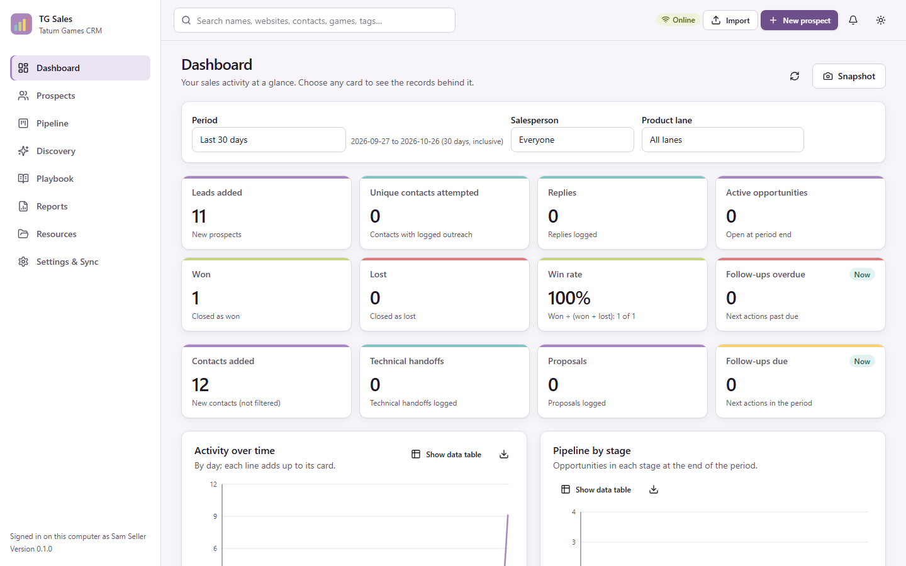
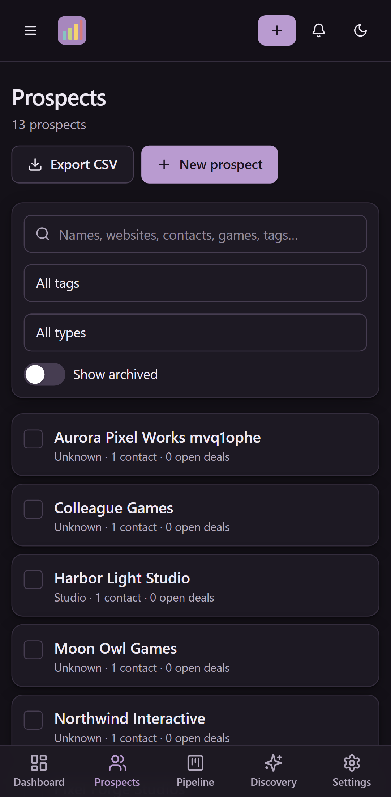

# TG Sales CRM (`tg_sales`)

The Tatum Games sales CRM and game-market sales intelligence app. Salespeople
use it to find studios and publishers, track prospects and contacts, move
opportunities through a pipeline, log outreach, discover upcoming and recent
Steam releases, reuse approved outreach language, and report on results.

It is a web application (React + TypeScript, FastAPI, PostgreSQL) that runs
**entirely on your own computer**: `launch.bat` starts a private database and
the app, and your browser shows it. No account, cloud service or subscription
is needed. The same architecture can later be hosted centrally for a team.

| Light | Dark (phone) |
|-------|--------------|
|  |  |

## What it does

- **Dashboard**: KPIs for any period (7 days to 12 months, calendar periods,
  custom), by salesperson and product lane, from recorded history; charts with
  data tables and CSV; drill-down to the records; one-click PNG snapshots.
- **Prospects**: studios, publishers and other companies with multiple
  contacts, games, notes, tags, links and a full activity timeline; duplicate
  warnings; bulk tagging, archiving and safe CSV export.
- **Import**: CSV, Excel (.xlsx) and text files with automatic column
  recognition, preview, match review, atomic commit, problem reports, import
  history and undo. Outreach status is never guessed.
- **Pipeline**: product lanes (data licensing, publisher partnership, MIKROS
  Marketing), custom stages, drag and drop (mouse, touch, keyboard) or a menu,
  won/lost reasons, outreach logging, tasks and follow-ups, technical-review
  handoffs.
- **Discovery**: Steam games releasing in the next 90 days or released in the
  last 150 days, with transparent scoring, provenance, business contacts only
  from official sources, and duplicate-safe saving to the CRM.
- **Playbook**: outreach templates for email, LinkedIn and calls with
  placeholders, previews, length checks, revisions, approval and outcomes.
- **Reports**: PDF reports with CSV data and an HTML preview for any period.
- **Collaboration**: exchange encrypted change files with colleagues (no
  server); conflicts are shown field by field and never overwritten silently.
- **Settings, Resources, Backups**: preferences, bookmarks, company logo,
  verified automatic backups and safe restore, transfer of data from the
  earlier desktop version.
- **Responsive and installable**: works on desktop, tablet and phone browsers;
  can be installed as an app (PWA).

## Install (salespeople)

1. Download `tg_sales_windows_x64_v<version>.zip` from the
   [GitHub Releases](https://github.com/TATUMGAMES/TG-SALES-TOOL/releases)
   page (the "Source code" archives are for developers, not for running).
2. Extract the whole ZIP to a folder you can write to.
3. Double-click **`launch.bat`**. Your browser opens TG Sales CRM. Keep the
   tg_sales window open while you work; close it or run **`stop.bat`** to quit.

Everything needed (including PostgreSQL) is in the ZIP; nothing else is
installed. Your data lives in `%LOCALAPPDATA%\TatumGames\tg_sales`, separate
from the program, so updating means replacing the folder. Windows SmartScreen
may warn about an unsigned program: compare the ZIP's SHA-256 with
`SHA256SUMS.txt` from the release, then choose "More info" › "Run anyway".
See [docs/USER_GUIDE.md](docs/USER_GUIDE.md) and
[docs/TROUBLESHOOTING.md](docs/TROUBLESHOOTING.md).

## Your data stays on your computer

The database only accepts connections from your own computer, there is no
telemetry, and nothing is sent anywhere unless you use Game discovery (public
Steam store pages and official studio websites) or export a sync file
yourself. Details: [docs/SECURITY.md](docs/SECURITY.md).

## Developer setup

Requirements: Windows 10/11, Python 3.13, Node.js 22+, Git. Docker is optional.

```bat
setup.bat          :: Python environment (hash-verified), PostgreSQL runtime, web build
launch.bat         :: run the app at http://127.0.0.1:8765
```

Development with hot reload, tests, and the quality gate:

```powershell
.venv\Scripts\python -m tg_sales.launcher start --no-browser   # API + database
cd web; npm run dev                                            # http://127.0.0.1:5173
powershell -File scripts\check.ps1 [-E2E] [-Audit]             # all checks
```

See [docs/DEVELOPMENT.md](docs/DEVELOPMENT.md) and [docs/TESTING.md](docs/TESTING.md).

## Documentation

| Topic | Document |
|-------|----------|
| Architecture, technology stack, project structure | [docs/ARCHITECTURE.md](docs/ARCHITECTURE.md) |
| Development (backend, frontend, migrations) | [docs/DEVELOPMENT.md](docs/DEVELOPMENT.md) |
| Testing | [docs/TESTING.md](docs/TESTING.md) |
| HTTP API (generated) | [docs/API.md](docs/API.md) |
| PostgreSQL schema and migrations | [docs/DATA_MODEL.md](docs/DATA_MODEL.md) |
| Moving data from the desktop version | [docs/MIGRATION.md](docs/MIGRATION.md) |
| Installation, Windows distribution, Docker, hosting | [docs/DEPLOYMENT.md](docs/DEPLOYMENT.md) |
| Using the app | [docs/USER_GUIDE.md](docs/USER_GUIDE.md) |
| Collaboration (sync) | [docs/SYNC.md](docs/SYNC.md) |
| Reports and snapshots | [docs/REPORTS.md](docs/REPORTS.md) |
| KPI definitions | [docs/KPI_DICTIONARY.md](docs/KPI_DICTIONARY.md) |
| Importing files | [docs/IMPORTING.md](docs/IMPORTING.md) |
| Game discovery data sources | [docs/DATA_SOURCES.md](docs/DATA_SOURCES.md) |
| Interface design | [docs/UI_DESIGN.md](docs/UI_DESIGN.md) |
| Security and privacy | [docs/SECURITY.md](docs/SECURITY.md) |
| Troubleshooting | [docs/TROUBLESHOOTING.md](docs/TROUBLESHOOTING.md) |
| Requirements and traceability | [docs/REQUIREMENTS.md](docs/REQUIREMENTS.md) |
| Design decisions | [docs/DECISIONS.md](docs/DECISIONS.md) |
| Changes | [CHANGELOG.md](CHANGELOG.md) |

## Contributing

Work on a branch, keep `scripts\check.ps1 -E2E` green, update the affected
documentation (the API reference and TypeScript API types are generated by
`scripts\generate_api_types.py`), and open a pull request. CI runs the same
checks on every push.

## Privacy

This repository is public. It contains source code, documentation and
synthetic test data only. Never commit real prospect lists, contact details,
sales data, databases, backups, sync packages, credentials or internal company
documents (`.gitignore` excludes them; check `git status` anyway).

## License

Proprietary. Copyright © 2026 Tatum Games. All rights reserved. See
[LICENSE](LICENSE).
