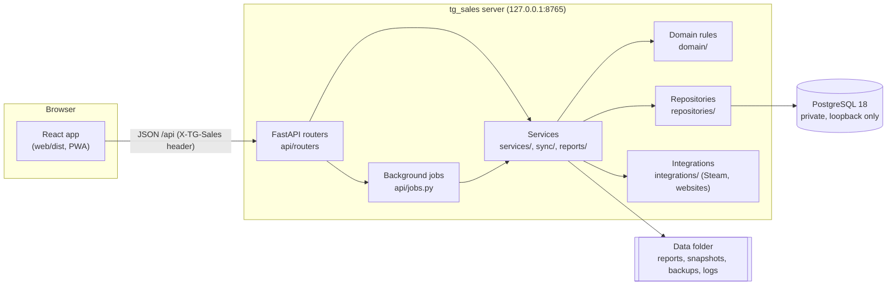

# Architecture

TG Sales CRM is a **modular monolith**: one Python server (FastAPI) with the
business logic, one PostgreSQL database, and one React single-page app served
by the same server. Locally everything runs on the salesperson's computer; the
same pieces can later run on a server for a team.



## Technology stack

| Layer | Technology |
|-------|------------|
| Web app | React 19, TypeScript (strict), Vite 7, Tailwind CSS 4, shadcn/ui-style components on Radix UI, React Router 7, TanStack Query 5, React Hook Form + Zod, Recharts, dnd-kit, Lucide icons, sonner (toasts), html-to-image (snapshots), vite-plugin-pwa |
| Server | Python 3.13, FastAPI, Pydantic 2 / pydantic-settings, Uvicorn |
| Data | PostgreSQL 18, SQLAlchemy 2, Alembic, psycopg 3 |
| Documents | ReportLab (PDF), SVG charts, openpyxl (Excel import), Pillow (image validation) |
| Security | cryptography (AES-GCM sync encryption, scrypt) |
| Local runtime | Portable PostgreSQL (EDB Windows binaries), PyInstaller one-folder `tg_sales.exe`, `launch.bat` / `stop.bat` |
| Tests | Pytest (+ Hypothesis available), Vitest + React Testing Library, Playwright, Ruff, mypy (strict), `tsc` |
| Infrastructure | Docker Compose and Dockerfile (optional), GitHub Actions (CI and release) |

## Project structure

```
src/tg_sales/
  domain/         Pure rules: prospects, importing, pipeline, KPIs, discovery scoring,
                  playbook, periods, snapshots naming (no database, network or web)
  repositories/   SQLAlchemy queries
  services/       Use cases: prospects, imports, pipeline, KPIs, discovery, playbook,
                  snapshots, report catalog, backups, settings, resources, branding
  reports/        Report content, SVG/ReportLab charts, PDF/HTML documents, generator
  sync/           Offline collaboration: package format (zip, hashes, encryption), merge engine
  integrations/   HTTP client (rate limits, robots.txt), Steam adapter, website contact finder
  db/             Models, PostgreSQL engine/session, Database (open, migrate, health),
                  migrations_pg/ (Alembic chain for PostgreSQL)
  legacy/         Reading databases of the earlier desktop version (SQLite) and transferring them
  api/            FastAPI app, settings, security middleware, jobs, routers per feature
  launcher/       Portable PostgreSQL runtime and the local start/stop launcher
web/
  src/components/ UI kit (button, form fields, dialog/sheet, menus, tabs, cards…), layout shell
  src/features/   One folder per screen: dashboard, prospects, imports, pipeline, discovery,
                  playbook, reports, resources, settings (incl. sync, backups), onboarding
  src/lib/        API client, generated API types, job polling, formatting, theme, CSV
  e2e/            Playwright browser tests
deploy/           Dockerfile, docker-compose.yml, .env.example
scripts/          setup, quality gate, Windows build, smoke test, generators, benchmark
tests/            unit/, integration/ (PostgreSQL), api/ (HTTP), e2e server helpers
```

Dependency rules are enforced by `tests/unit/test_architecture.py`: domain code
never imports the database, network or web layers; services never import the
web layer; nothing imports a desktop toolkit.

## Request flow

1. The browser calls `/api/...` with JSON. State-changing calls carry the
   `X-TG-Sales: 1` header; the security middleware checks the host name,
   origin and header, then adds strict security headers.
2. A router validates input with Pydantic models (unknown fields are refused)
   and calls a service. Response models are the services' own dataclasses, so
   the OpenAPI schema (and the generated TypeScript types in
   `web/src/lib/api-types.ts`) always match the server.
3. Services open a database session per unit of work (commit on success,
   rollback on error). Every new row gets a UUIDv7 id, UTC timestamps and the
   creating device id.
4. Slow work (import planning/commit, discovery, report generation, backups,
   restore, sync export/import, desktop transfer) runs as a background job
   with progress and cancellation; the browser polls `/api/jobs/{id}`.
5. Expected failures raise `TgSalesError` (message + next action), returned as
   `{"error": {...}}` and shown as toasts or inline errors in the app.

## Data and history

- PostgreSQL is the single source of truth (see [DATA_MODEL.md](DATA_MODEL.md)).
- The **activity ledger** is append-only (enforced by a database trigger);
  mistakes are corrected with correction events. KPIs and reports are computed
  from recorded events, never reconstructed from current state
  ([KPI_DICTIONARY.md](KPI_DICTIONARY.md)).
- A **change log** written by database triggers records every change to
  synchronized tables; offline sync is built on it ([SYNC.md](SYNC.md)).
- Files (reports, snapshots, backups, logs, logo, caches) live in the data
  folder; their metadata is in the database.

## Local runtime

`launch.bat` → `tg_sales.exe start` (or `python -m tg_sales.launcher start`
from source):

1. Single instance: if tg_sales already runs, the browser is opened at it.
2. The portable PostgreSQL in `runtime/postgresql` is initialized on first run
   in `%LOCALAPPDATA%\TatumGames\tg_sales\postgres` (random passwords,
   loopback-only `pg_hba.conf`, SCRAM) and started.
3. The database is opened; pending migrations run after a verified backup.
4. Uvicorn serves the API and `web/dist` on `127.0.0.1:8765` (next free port
   if busy) and the browser opens. Scheduled backups run in the background.
5. Closing the window or `stop.bat` stops the server, then PostgreSQL.

## Frontend

- Routes are lazy-loaded pages inside one shell (sidebar on desktop, menu
  sheet plus bottom navigation on phones and tablets).
- Server state lives in TanStack Query; mutations invalidate the affected
  queries. There is no duplicated business logic in the browser: placeholder
  filling, handoff text, KPI numbers, validation rules and periods come from
  the API.
- Theme tokens (light/dark) are CSS variables derived from the brand palette;
  a tiny same-origin script applies the saved theme before first paint.
- The service worker caches only the app shell; API responses are
  `Cache-Control: no-store` and never cached.

## Ready for hosting and mobile

- All configuration is in environment variables (`api/settings.py`); the API
  is documented ([API.md](API.md)) and independent of the web app, so a React
  Native/Expo app can reuse it.
- Ownership (`owner_actor_id`), authorship (`actor_id`, `author_actor_id`) and
  an audit trail (the ledger and change log) are already in the schema; adding
  user accounts, sign-in and roles is the main step before a team-hosted
  deployment ([DEPLOYMENT.md](DEPLOYMENT.md)).
