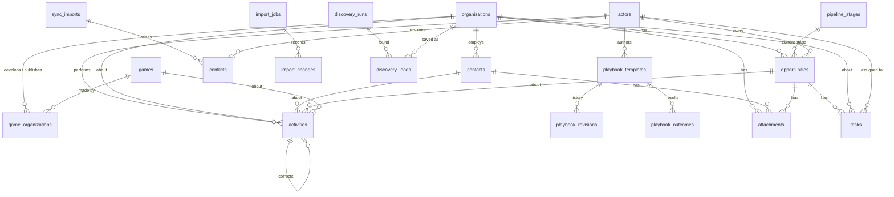

# tg_sales Data Model

**Schema revision: `0002`** (PostgreSQL Alembic revision in
`src/tg_sales/db/migrations_pg/versions/`).

This document describes every table and column in the tg_sales PostgreSQL
database. It is checked by the test suite: every table and column in the
models must appear here. When a migration changes the schema, update the
revision number above and the affected sections, and add an entry to the
revision history at the end.

Databases from the earlier desktop version (SQLite, desktop revisions
`0001`–`0005`) are not opened directly; they are transferred into PostgreSQL
by the desktop-data transfer (see [MIGRATION.md](MIGRATION.md)). Their tables
and columns are the same as the PostgreSQL tables below, except the tables
and columns marked *(new in the web version)*.

## Conventions

- **Storage:** PostgreSQL (18 on the local install), one database named
  `tg_sales`. Locally it is a private server for one Windows user, listening
  on `127.0.0.1` only (see [DEPLOYMENT.md](DEPLOYMENT.md)).
- **Identifiers:** `id` is a UUIDv7 stored as 36-character lowercase text,
  unique across all computers without coordination. Built-in rows shared by
  every installation (the default pipeline stages) use fixed UUIDv5 ids so
  sync never duplicates them.
- **Timestamps:** `timestamp with time zone`, always written and read in UTC
  (connections run with `timezone=UTC`). Columns ending in `_utc` are UTC;
  local time is used only for display. Calendar dates (e.g. game release
  dates) use the `date` type.
- **Bookkeeping columns** on every table:

  | Column | Meaning |
  |--------|---------|
  | `id` | Globally unique identifier |
  | `created_at_utc` | When the row was created (for activities: when the event was recorded) |
  | `updated_at_utc` | Last change to the row (indexed, used for change detection) |
  | `created_by_device_id` | Device id of the computer that created the row |
  | `deleted_at_utc` | Tombstone: set instead of deleting, so deletions can be synchronized |

- **Soft deletion:** rows are never physically deleted by normal use. Queries
  for live data filter on `deleted_at_utc IS NULL`. Unique rules apply only to
  live rows (partial unique indexes), so a deleted record can be re-created.
- **Enumerations** are stored as lowercase text (validated by the application,
  no database CHECK constraint, so new values can be added without rebuilding
  tables). Missing information is stored as an explicit `unknown` value or
  `NULL`, never as a guessed default.
- **JSON** columns are `jsonb`.
- **Foreign keys** are all `DEFERRABLE INITIALLY IMMEDIATE`, so imports and
  sync merges can insert related rows in any order within one transaction.
- **System device:** rows created by migrations have
  `created_by_device_id = 00000000-0000-0000-0000-000000000000`.

## Entity relationships

An organization (studio, publisher or data buyer) can have many contacts,
games and opportunities, and can have opportunities in several product lanes
at the same time. A game is linked to its developers and publishers through
`game_organizations`, so a game is never confused with the studio that made it.

## Tables

### `actors`

People who own opportunities and perform activities. Each computer has one
current actor, referenced by the device-scoped setting `current_actor_id`.

| Column | Type | Notes |
|--------|------|-------|
| `display_name` | text | Name shown to teammates; defaults to "Salesperson" until set |

### `organizations`

Studios, publishers, data buyers and other companies.

| Column | Type | Notes |
|--------|------|-------|
| `name` | text | As entered or imported |
| `normalized_name` | text | Case/punctuation-insensitive form for duplicate detection (indexed) |
| `website` | text, nullable | Normalized `http(s)` address (other schemes are refused) |
| `domain` | text, nullable | Lowercase host without `www.` (indexed) |
| `location` | text, nullable | City/region |
| `country` | text, nullable | |
| `company_type` | enum | `unknown`, `studio`, `publisher`, `data_buyer`, `other` |
| `source` | enum | `manual`, `import`, `discovery`, `sync`, `system` |
| `tags` | JSON list | User labels |
| `notes` | text, nullable | |
| `archived_at_utc` | timestamp, nullable | Set when archived (hidden from the list, reversible); `NULL` = active |
| `reviewed_on` | date, nullable | When the prospect was last reviewed or qualified; not a contact or follow-up date *(new in the web version, 0002)* |
| `qualification_source_url` | text, nullable | Page where the prospect was found or qualified, kept exactly as entered (query and `#fragment` included); only `http(s)` addresses. Separate from `source`, which says how the record entered the CRM *(0002)* |
| `custom_fields` | JSON object | Values of custom fields by field key, e.g. `{"account_tier": "Tier 1"}` (see `custom_fields` table); `{}` when none *(0002)* |

Indexes: `normalized_name`, `domain`, `created_at_utc`, `updated_at_utc`.

Duplicate rules: the same identifying website domain or contact email is
strong evidence of the same organization; the same or a similar name is only a
suggestion, because different studios can have similar names. Shared hosts
(webmail, social networks, stores such as `itch.io` or `steampowered.com`) never
count as identifying domains.

### `contacts`

People at an organization. Only business contact details are stored.

| Column | Type | Notes |
|--------|------|-------|
| `organization_id` | FK → organizations | Required (indexed) |
| `name` | text, nullable | |
| `role_title` | text, nullable | |
| `business_email` | text, nullable | As entered |
| `email_normalized` | text, nullable | Lowercased for matching (indexed) |
| `social_urls` | JSON object | e.g. `{"linkedin": "https://…"}` |
| `contact_status` | enum | `unknown` (default), `not_contacted`, `attempted`, `responded`; never inferred from the presence of an email |
| `notes` | text, nullable | |
| `provenance` | text, nullable | How the contact was obtained (file, discovery source…) |
| `source_url` | text, nullable | Public page where the contact information was found |
| `source` | enum | As for organizations |
| `archived_at_utc` | timestamp, nullable | Set when archived; `NULL` = active |
| `custom_fields` | JSON object | Values of contact custom fields by key; `{}` when none *(0002)* |

Indexes: `organization_id`, `email_normalized`, `created_at_utc`, `updated_at_utc`.

### `games`

| Column | Type | Notes |
|--------|------|-------|
| `title` | text | |
| `platform` | text, nullable | e.g. `pc` |
| `store` | text, nullable | e.g. `steam` |
| `store_id` | text, nullable | Store's id (e.g. Steam app id) |
| `store_url` | text, nullable | |
| `release_date` | date, nullable | `NULL` when unknown ("Coming soon") |
| `release_precision` | enum | `day`, `month`, `quarter`, `year`, `unknown` |
| `source` | enum | As for organizations |
| `discovered_at_utc` | timestamp, nullable | When discovery first saw the game |

Indexes: unique (`store`, `store_id`) among live rows with a store id; `release_date`.

### `game_organizations`

| Column | Type | Notes |
|--------|------|-------|
| `game_id` | FK → games | (indexed) |
| `organization_id` | FK → organizations | (indexed) |
| `role` | enum | `developer` or `publisher`; a game may have several of each |

Indexes: unique (`game_id`, `organization_id`, `role`) among live rows.

### `pipeline_stages`

User-configurable stages. Ten default stages are created by the first
migration with fixed ids: Discovered, Researching, Contacted, Follow-Up,
Interested, Technical Review, Negotiation, Won, Lost, Not a Fit.

| Column | Type | Notes |
|--------|------|-------|
| `name` | text | User-visible label |
| `sort_order` | integer | Display order |
| `product_lane` | text(32), nullable | Key of the sales lane the stage is limited to (`sales_lanes.key`); `NULL` = all lanes |
| `outcome` | enum | `open`, `won`, `lost`, `not_a_fit`; anything but `open` is terminal |
| `archived_at_utc` | timestamp, nullable | Archived stages are hidden but keep their history |

Stage ids never change, so renaming or reordering never affects history.
Archiving a stage first moves its opportunities (with normal `stage_change`
events). At least one open stage for all lanes must remain, and a stage's
`outcome` cannot change while it holds opportunities.

### `sales_lanes`

*(0002)* The business categories of opportunities ("lanes"), such as
"Consulting" or "Data licensing". Lanes are not stages: every lane uses the
same stages, and a stage may be limited to one lane.

| Column | Type | Notes |
|--------|------|-------|
| `key` | text(32) | Permanent identifier stored in `opportunities.product_lane` and `pipeline_stages.product_lane`; never changes, so renaming keeps all records and history (unique) |
| `name` | text | Display name (renamable) |
| `description` | text, nullable | |
| `color` | text(16), nullable | `#rrggbb`, always shown with the name |
| `sort_order` | integer | Display order |
| `technical_handoff` | boolean | Offers the technical-review handoff summary on its opportunities |
| `archived_at_utc` | timestamp, nullable | Archived lanes are hidden from new opportunities; their records stay |

The `id` is derived from the key (`uuid5`), so the same lane created on two
computers is one record after sync. Revision `0002` creates, for an existing
installation (one that already has prospects, opportunities, activity or
lane-specific stages), the original lanes `data_licensing` (Data licensing),
`publisher_partnership` (Publisher partnership) and `mikros_marketing` (MIKROS
Marketing); for a new installation `general_sales`, `partnerships` and
`other`. Any other key already used by a record also gets a lane. A lane can be
deleted (tombstoned) only when no opportunity or stage uses it.

### `custom_fields`

*(0002)* User-defined fields for prospects and contacts.

| Column | Type | Notes |
|--------|------|-------|
| `record_type` | text(16) | `prospect` (organizations) or `contact` |
| `key` | text(64) | Permanent key under which values are stored in the record's `custom_fields` JSON (unique with `record_type`) |
| `label` | text | Display name (renamable) |
| `field_type` | text(16) | `text`, `number`, `date` (ISO string), `url` (http(s), kept exactly) or `boolean`; never changes |
| `description` | text, nullable | |
| `sort_order` | integer | Display order |
| `archived_at_utc` | timestamp, nullable | Archived fields are hidden from forms, imports and exports; values are kept |

The `id` is derived from record type and key (`uuid5`), like lanes.

### `opportunities`

A potential deal with an organization in one sales lane.

| Column | Type | Notes |
|--------|------|-------|
| `organization_id` | FK → organizations | (indexed) |
| `product_lane` | text(32) | Key of the opportunity's sales lane (`sales_lanes.key`; indexed). Checked against active lanes when an opportunity is created |
| `stage_id` | FK → pipeline_stages | Current stage (indexed); history lives in `activities` |
| `owner_actor_id` | FK → actors, nullable | (indexed) |
| `title` | text, nullable | |
| `estimated_value` | real, nullable | ≥ 0; `NULL` = not estimated |
| `currency` | text(3), nullable | ISO 4217 code |
| `probability` | real, nullable | 0–1; `NULL` = not estimated |
| `next_action_at_utc` | timestamp, nullable | Next follow-up (indexed) |
| `next_action_note` | text, nullable | |
| `outcome_reason` | text, nullable | Reason text recorded when reaching a terminal stage; cleared when reopened |
| `outcome_reason_code` | text(32), nullable | Reason code for won / lost / not a fit (see below); cleared when reopened |
| `closed_at_utc` | timestamp, nullable | When it entered a terminal stage; cleared if reopened |

Constraints: `probability` between 0 and 1; `estimated_value` ≥ 0.

Reason codes (required when moving to a terminal stage):
`won`: `signed`, `pilot`, `expanded`, `other`;
`lost`: `price`, `timing`, `competitor`, `no_response`, `internal`,
`data_not_available`, `other`;
`not_a_fit`: `wrong_segment`, `too_small`, `no_need`, `duplicate`, `other`.

### `tasks`

To-do items for an opportunity (for example "Send sample data"). Completing
a task writes a `task_completed` event.

| Column | Type | Notes |
|--------|------|-------|
| `opportunity_id` | FK → opportunities, nullable | (indexed) |
| `organization_id` | FK → organizations, nullable | Copied from the opportunity for fast lookups (indexed) |
| `assignee_actor_id` | FK → actors, nullable | (indexed) |
| `title` | text | What needs to be done |
| `due_at_utc` | timestamp, nullable | (indexed); open tasks due today or earlier appear as Dashboard reminders |
| `completed_at_utc` | timestamp, nullable | `NULL` = open |

### `activities`

The immutable event ledger. `id` is the event id. `occurred_at_utc` is when
the event happened (may be backdated); `created_at_utc` is when it was
recorded. Database triggers reject any `UPDATE` or `DELETE`; mistakes are fixed
with a `correction` event that references the original.

| Column | Type | Notes |
|--------|------|-------|
| `occurred_at_utc` | timestamp | (indexed; also with `type` and with `opportunity_id`) |
| `type` | enum | See event types below |
| `actor_id` | FK → actors, nullable | Who performed it; `NULL` for unknown historical events (indexed) |
| `organization_id` | FK → organizations, nullable | (indexed) |
| `contact_id` | FK → contacts, nullable | (indexed) |
| `opportunity_id` | FK → opportunities, nullable | |
| `game_id` | FK → games, nullable | (indexed) |
| `corrects_event_id` | FK → activities, nullable | For `correction` events (indexed) |
| `payload` | JSON object | Structured details (see below) |
| `source` | enum | `manual`, `import`, `discovery`, `sync`, `system` |

Event types: `opportunity_created`, `stage_change`, `field_change`,
`correction`, `note`, `organization_created`, `import_committed`,
`import_undone`, `task_created`, `task_completed`, `contacted`, `email`,
`linkedin_invite`,
`linkedin_message`, `phone_call`, `meeting`, `reply`, `demo`,
`data_room_shared`, `technical_handoff`, `proposal`, `won`, `lost`, `closed`.

Payloads:

| Type | Payload |
|------|---------|
| `opportunity_created` | `{"stage_id", "product_lane", "to_outcome"}` (`to_outcome` recorded from this release on) |
| `stage_change` | `{"from_stage_id", "to_stage_id", "to_outcome", "reason", "reason_code"}` |
| Logged interactions (`email`, `linkedin_invite`, `linkedin_message`, `phone_call`, `meeting`, `reply`, `demo`, `data_room_shared`, `technical_handoff`, `proposal`, `contacted`, `closed`) | `{"note", "logged_manually": true}` — recorded by the salesperson; tg_sales never sends messages |
| `task_created` / `task_completed` | `{"task_id", "title"}` |
| `correction` | `{"void", "occurred_at_utc", "reason", "original": {"type", "occurred_at_utc", "payload"}}` |
| `field_change` | `{"entity", "entity_id", "changes": {field: {"old", "new"}}}`; `entity` is `organizations`, `contacts`, `games`, `opportunities`, `pipeline_stages` or `tasks` |
| `note` | `{"text"}` |
| `organization_created` | `{"name"}` (plus `import_job_id` when created by an import) |
| `import_committed` | `{"import_job_id", "file_name", "created", "updated", "skipped", "errors"}` |
| `import_undone` | `{"import_job_id", "file_name", "reverted", "kept"}` |

### `playbook_templates`

| Column | Type | Notes |
|--------|------|-------|
| `title` | text | |
| `label` | text, nullable | User-defined label |
| `category` | text, nullable | |
| `channel` | text, nullable | e.g. email, LinkedIn message |
| `audience` | text, nullable | |
| `stage` | text, nullable | Pipeline stage the message is meant for |
| `body` | text | Message text with placeholders |
| `notes` | text, nullable | |
| `author_actor_id` | FK → actors, nullable | (indexed) |
| `tags` | JSON list | |
| `is_favorite` | boolean | |
| `is_approved` | boolean | Business approval status |
| `revision` | integer | Current revision number |
| `archived_at_utc` | timestamp, nullable | |
| `example_key` | text(64), nullable | Identifies a built-in example template, so it is not added twice (unique among live rows) |

Editing the title or message of an approved template clears `is_approved`.

### `playbook_revisions`

The full content of a template at each saved revision; restoring an old
revision adds a new revision with that content.

| Column | Type | Notes |
|--------|------|-------|
| `template_id` | FK → playbook_templates | (indexed) |
| `revision` | integer | Unique per template among live rows |
| `content` | JSON | `{"title", "body", "channel", "label", "category", "audience", "stage", "notes", "tags"}` |
| `summary` | text | What changed, e.g. "Changed message, tags" or "Restored revision 2" |
| `author_actor_id` | FK → actors, nullable | (indexed) |

### `playbook_outcomes`

Results of using a template, recorded manually by the salesperson.

| Column | Type | Notes |
|--------|------|-------|
| `template_id` | FK → playbook_templates | (indexed) |
| `revision` | integer | Template revision that was current when recorded |
| `outcome` | text(24) | `reply`, `meeting`, `no_reply`, `not_interested`, `other` |
| `note` | text, nullable | |
| `recorded_at_utc` | timestamp | |
| `author_actor_id` | FK → actors, nullable | (indexed) |

### `import_jobs`

| Column | Type | Notes |
|--------|------|-------|
One row per saved import. `id` is the import id, generated when the import is
prepared, so saving the same prepared import twice is refused. Only file
metadata is kept; the file and its raw rows are not copied into the database.

| Column | Type | Notes |
|--------|------|-------|
| `file_name` | text | Original file name without its folder (the file itself is not copied) |
| `file_sha256` | text(64) | Content hash, used to recognize a file imported before (indexed) |
| `file_size_bytes` | integer | |
| `file_type` | text(16) | `csv`, `xlsx`, `txt` |
| `sheet_name` | text, nullable | Excel sheet that was imported |
| `status` | text(32) | `committed` or `undone` |
| `started_at_utc` | timestamp | |
| `finished_at_utc` | timestamp, nullable | Every row the import wrote is timestamped at or before this |
| `created_count` | integer | Organizations created |
| `updated_count` | integer | Existing organizations that gained details, contacts or games |
| `skipped_count` | integer | Organizations skipped (already up to date, or skipped by the user) |
| `error_count` | integer | Source rows not imported because of errors |
| `warning_count` | integer | Warnings reported for the import |
| `mapping` | JSON object | `{"columns": [{"header", "field"}], "date_order"}` |
| `error_summary` | text, nullable | Error messages with counts (no row values) |
| `undone_at_utc` | timestamp, nullable | When the import was undone |

### `import_changes`

The change log that makes imports reversible: one row per record an import
created or updated, plus one `row` entry per source row with its fingerprint.

| Column | Type | Notes |
|--------|------|-------|
| `import_job_id` | FK → import_jobs | (indexed) |
| `entity_table` | text(64) | `organizations`, `contacts`, `games` or `game_organizations` |
| `entity_id` | text(36) | The record's id (indexed) |
| `action` | text(16) | `created`, `updated`, or `row` (fingerprint only) |
| `row_number` | integer, nullable | Line or row number in the source file |
| `row_fingerprint` | text(64), nullable | SHA-256 of the row's normalized content; recognizes re-imported rows (indexed) |
| `previous_values` | JSON object | For `updated`: the values the import replaced (imports only fill empty fields) |

Undo tombstones created records and restores previous values in one
transaction. Records edited after the import (`updated_at_utc` later than the
job's `finished_at_utc`), and organizations that gained opportunities, manual
contacts or later activity, are kept.

### `discovery_runs`

| Column | Type | Notes |
|--------|------|-------|
| `source` | text(64) | Discovery source adapter |
| `parameters` | JSON object | Filters used |
| `status` | text(32) | |
| `started_at_utc` | timestamp | |
| `finished_at_utc` | timestamp, nullable | |
| `result_count` | integer | |
| `error` | text, nullable | |

### `discovery_leads`

The discovery review queue: one row per source game (unique `source` +
`external_id` among live rows). Later runs refresh the data but keep the
review status and any contact the user found or verified.

| Column | Type | Notes |
|--------|------|-------|
| `run_id` | FK → discovery_runs, nullable | Run that last refreshed it (indexed) |
| `source` | text(32) | e.g. `steam` |
| `external_id` | text(64) | The source's id (Steam app id) |
| `title` | text | Game title |
| `data` | JSON object | Normalized source data: type (game/DLC), developers, publishers, genres, categories, platforms, languages, website, store support contact, release wording, base game of a DLC, retrieval time, whether served from cache |
| `release_date` | date, nullable | `NULL` when not announced |
| `release_precision` | enum | `day`, `month`, `quarter`, `year`, `unknown` |
| `status` | text(16) | `new`, `saved`, `dismissed` (indexed) |
| `contact_status` | text(24) | `not_found`, `needs_verification`, `verified_source` |
| `contact_email` | text, nullable | Only an address published on a named public page; never inferred |
| `contact_source_url` | text, nullable | Page where the address was found |
| `provenance_url` | text | Store page the details came from |
| `last_checked_at_utc` | timestamp | When the source data was retrieved; older than a day is shown as outdated |
| `organization_id` | FK → organizations, nullable | Prospect created or updated from this lead (indexed) |

### `sync_exports`

A change package exported from this computer (`id` is the export id).

| Column | Type | Notes |
|--------|------|-------|
| `file_name` | text | |
| `watermark` | JSON object | What the export covered |
| `record_count` | integer | |
| `event_count` | integer | |
| `encrypted` | boolean | |

### `sync_imports`

| Column | Type | Notes |
|--------|------|-------|
| `export_id` | text(36) | Id of the imported package; unique among live rows |
| `source_device_id` | text(36) | Computer that exported it |
| `file_name` | text | |
| `file_sha256` | text(64) | |
| `status` | text(32) | |
| `imported_at_utc` | timestamp, nullable | |
| `counts` | JSON object | Created/updated/skipped counts |

### `conflicts`

| Column | Type | Notes |
|--------|------|-------|
| `sync_import_id` | FK → sync_imports, nullable | (indexed) |
| `entity_table` | text(64) | Table of the conflicting record (indexed with `entity_id`) |
| `entity_id` | text(36) | |
| `field` | text(64), nullable | `NULL` = whole-record conflict |
| `local_value` | JSON, nullable | |
| `incoming_value` | JSON, nullable | |
| `status` | text(32) | |
| `resolution` | text(32), nullable | |
| `resolved_at_utc` | timestamp, nullable | |
| `resolved_by_actor_id` | FK → actors, nullable | (indexed) |

### `attachments`

| Column | Type | Notes |
|--------|------|-------|
| `organization_id` | FK → organizations, nullable | (indexed) |
| `contact_id` | FK → contacts, nullable | (indexed) |
| `opportunity_id` | FK → opportunities, nullable | (indexed) |
| `file_name` | text | |
| `relative_path` | text | Inside the attachments folder |
| `sha256` | text(64) | |
| `size_bytes` | integer | |
| `media_type` | text(128), nullable | |

### `snapshots`

| Column | Type | Notes |
|--------|------|-------|
| `relative_path` | text | Inside the snapshots folder |
| `filters` | JSON object | Dashboard filters at capture time |
| `generated_at_utc` | timestamp | |
| `app_version` | text(32) | |
| `width_px` | integer, nullable | |
| `height_px` | integer, nullable | |

### `report_records`

*(new in the web version)* Metadata of generated reports; the files stay in
the reports data folder.

| Column | Type | Notes |
|--------|------|-------|
| `folder_name` | text(128) | Report folder inside the reports folder (unique) |
| `title` | text | Title and period |
| `period_start` | date | First day of the period |
| `period_end` | date | Last day of the period (inclusive) |
| `filters` | JSON object | Preset, salesperson, product lane and their description |
| `generated_at_utc` | timestamp | |
| `app_version` | text(32) | |
| `page_count` | integer, nullable | PDF pages |
| `has_html` | boolean | An HTML preview was saved |
| `totals` | JSON object | Headline numbers, as in the report |
| `author_actor_id` | FK → actors, nullable | Who created it |

### `resource_links`

*(new in the web version)* Bookmarks on the Resources page.

| Column | Type | Notes |
|--------|------|-------|
| `title` | text | |
| `kind` | text(16) | `link` (http(s) URL, synchronized) or `folder` (path on this computer, never synchronized) |
| `target` | text | The URL or folder path |
| `category` | text, nullable | Grouping on the page |
| `notes` | text, nullable | |
| `sort_order` | integer | |

### `sync_pending`

*(new in the web version)* Records received in a sync package that refer to a
record not received yet (packages imported out of order). Retried after
every import.

| Column | Type | Notes |
|--------|------|-------|
| `sync_import_id` | FK → sync_imports, nullable | Import that brought it (indexed) |
| `entity_table` | text(64) | Table of the waiting record |
| `entity_id` | text(36) | Its id |
| `change_id` | text(36) | The version it carries (unique with table and id) |
| `record` | JSON object | The record as received |
| `reason` | text | What it waits for |

### `change_log`

*(new in the web version)* One row per change to a synchronized record,
written by database triggers (not by application code), so no change can be
missed. Used to build sync packages and to recognize versions that were
already received. Has no bookkeeping columns.

| Column | Type | Notes |
|--------|------|-------|
| `seq` | bigint identity | Order of changes on this computer (primary key) |
| `entity_table` | text(64) | Changed table |
| `entity_id` | text(36) | Changed record |
| `change_id` | text(36) | Version produced by the change; kept as-is when the change came from a sync package |
| `device_id` | text(36), nullable | Computer that recorded it here |
| `origin` | text(8) | `local` or `sync` |
| `changed_at_utc` | timestamp | |

Synchronized tables: actors, organizations, contacts, games,
game_organizations, pipeline_stages, opportunities, tasks, activities,
playbook_templates, playbook_revisions, playbook_outcomes, settings (shared
scope only) and resource_links (web links only).

### `settings`

| Column | Type | Notes |
|--------|------|-------|
| `key` | text(128) | Unique per scope among live rows |
| `scope` | enum | `shared` (synchronized) or `device` (never leaves this computer) |
| `value` | JSON | |

Device-scoped keys: `device_id` (this computer's identity, created on first
run), `current_actor_id`.

## Integrity checks

- **Activities are immutable** in the database itself: a trigger rejects any
  `UPDATE`, `DELETE` or `TRUNCATE` of `activities`.
- **Change log triggers** on every synchronized table (see `change_log`).
- Schema upgrades run in one transaction (PostgreSQL DDL is transactional)
  after a verified backup; a failed upgrade changes nothing.
- The health check (Settings, About) confirms the schema revision, the
  safeguard triggers and that every constraint is validated, and reads every
  table.

## Revision history

| Revision | Summary |
|----------|---------|
| `0002` (PostgreSQL) | Configurable sales lanes (`sales_lanes`, seeded as described there), `custom_fields`; `organizations.reviewed_on`, `organizations.qualification_source_url`, `organizations.custom_fields`, `contacts.custom_fields`; change-log triggers on the new tables. No existing row is changed |
| `0001` (PostgreSQL) | Baseline for the web version: every table above, partial unique indexes, deferrable foreign keys, activity immutability and change-log triggers, default pipeline stages |

Desktop (SQLite) history, for databases transferred from the earlier version:

| Revision | Summary |
|----------|---------|
| `0001` | Initial schema: all tables above, activity immutability triggers, default pipeline stages |
| `0005` | Playbook history: new `playbook_revisions` and `playbook_outcomes` tables; `playbook_templates.example_key` |
| `0004` | New `discovery_leads` table (discovery review queue) |
| `0003` | Opportunity `outcome_reason_code`; new `tasks` table |
| `0002` | Prospect archiving (`organizations.archived_at_utc`, `contacts.archived_at_utc`); reversible imports (`import_jobs.warning_count`, `import_jobs.undone_at_utc`, new `import_changes` table) |
