# Interface design

## Principles

- For salespeople, not technicians: plain words, every error says what to do
  next, nothing irreversible without confirmation, nothing saved until the
  user confirms (imports, sync, restore).
- Fast: lazy-loaded screens, cached data refreshed in the background,
  optimistic pipeline moves, background jobs with progress and Cancel.
- Consistent: one component kit (`web/src/components/ui`), one shell, the same
  patterns on every screen (page header with actions, filter card, list,
  detail panel).

## Brand palette

| Color | Hex | Used for |
|-------|-----|----------|
| Purple | `#a787bd` | Primary accent, active navigation, leads metrics, publisher lane, open stages |
| Teal | `#86c4c2` | Data licensing lane, outreach metrics, funnel, progress |
| Green | `#c7d47f` | Won, win rate, success |
| Yellow | `#f6d271` | MIKROS Marketing lane, follow-ups, warnings, release windows |
| Coral | `#d87b7a` | Lost, overdue, danger |

The bright brand hues are fills and accents with dark text. Text-bearing
buttons use a deeper purple (`#6f4f8a` light, `#b99bd0` dark) so contrast
meets WCAG AA. Status is never shown by color alone (badges and words such as
"2 days overdue").

## Themes

Light and dark token sets in `web/src/index.css` (background, card, muted,
border, primary, success/warning/danger/info and their soft variants). The
choice (light, dark, follow the system) is remembered per browser and applied
before the first paint.

## Layout

| Size | Navigation | Lists | Details |
|------|------------|-------|---------|
| Desktop (≥ 1024 px) | Fixed sidebar | Tables | Side panels (sheets) |
| Tablet | Menu sheet + bottom bar | Tables or cards | Full-height panels |
| Phone | Menu sheet + bottom bar (Dashboard, Prospects, Pipeline, Discovery, Settings) | Cards | Full-screen panels; dialogs slide up from the bottom |

The pipeline scrolls horizontally inside its board with snap points; the page
itself never scrolls sideways (checked by the browser tests). Touch targets
are at least 32 px; safe-area insets are respected on phones.

## Components

Buttons (primary, secondary, outline, ghost, danger), fields with labels,
hints and errors, native selects (best on phones), switches, checkboxes, tabs,
menus (touch-safe), dialogs, side sheets, confirmation dialogs (optionally
"type a word"), toasts with actions, badges, cards, skeleton loaders, progress
bars, empty and error states, chart cards with a data-table view and CSV.

## Accessibility

Skip link, landmarks, labelled controls, keyboard support from Radix
primitives, a keyboard and menu alternative to drag and drop with
screen-reader announcements, visible focus rings, reduced-motion support, and
contrast-checked colors.

## Screens

| Desktop (light) | Phone (dark) |
|-----------------|--------------|
| 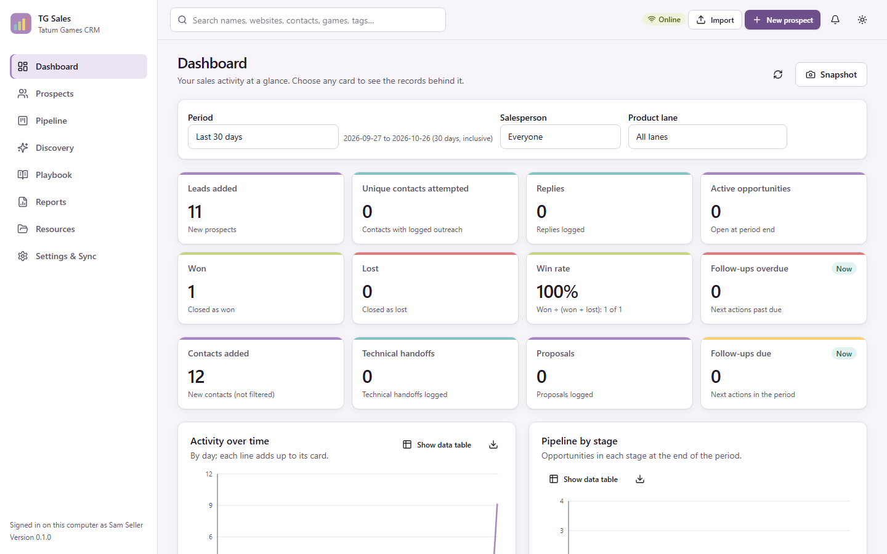 | 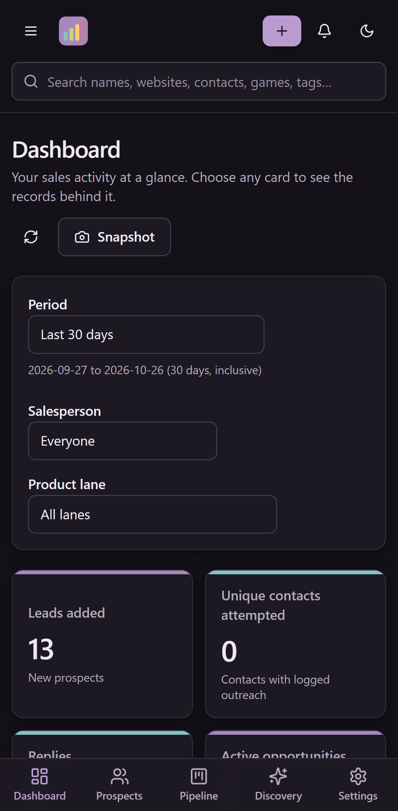 |
| 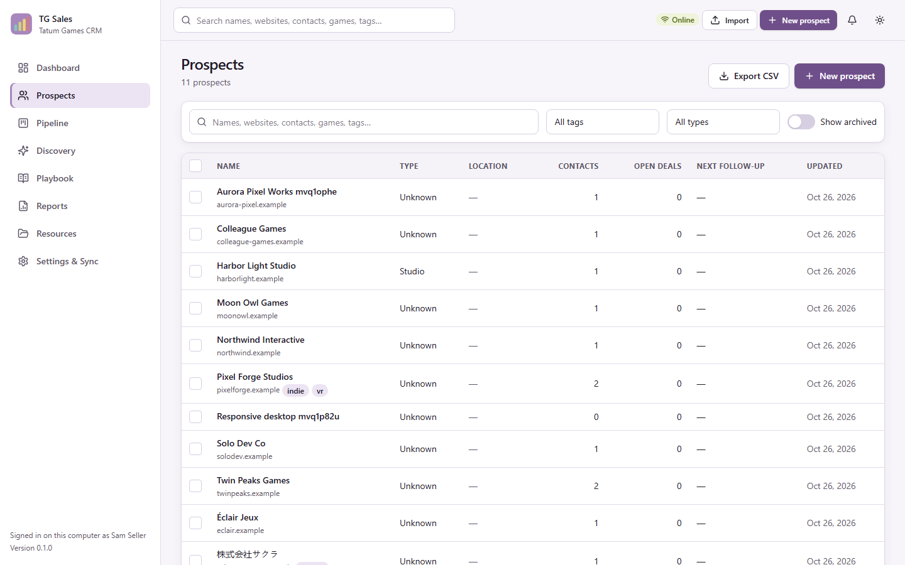 | 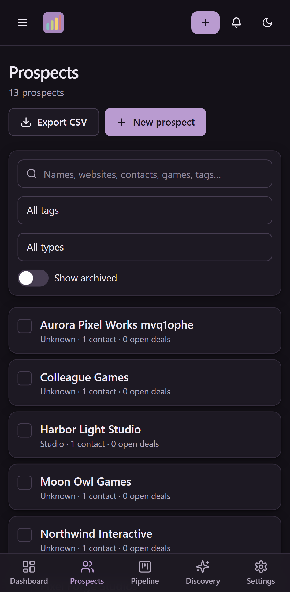 |
| 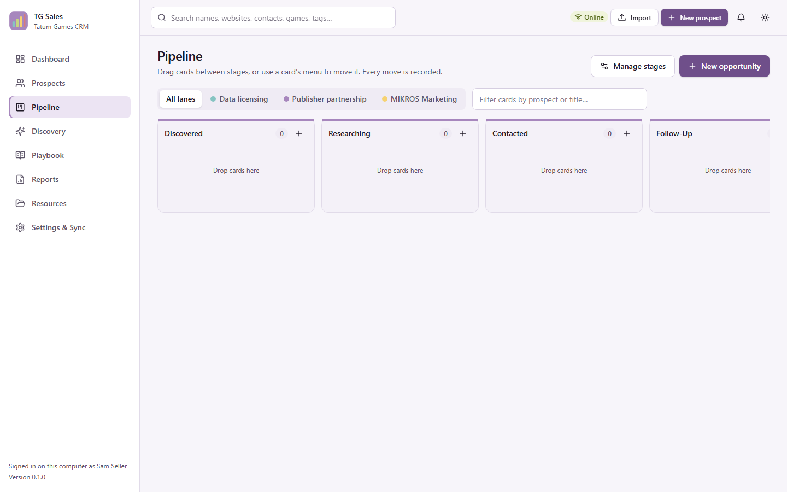 | 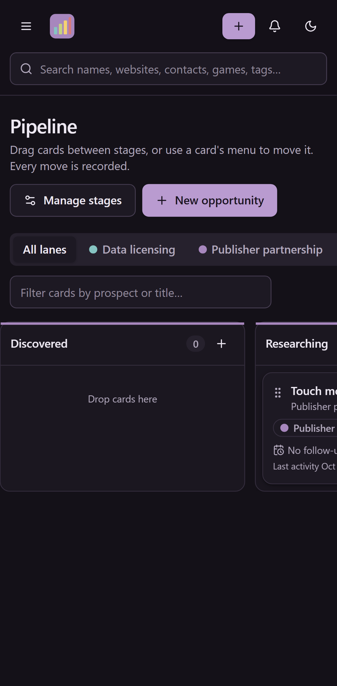 |
| 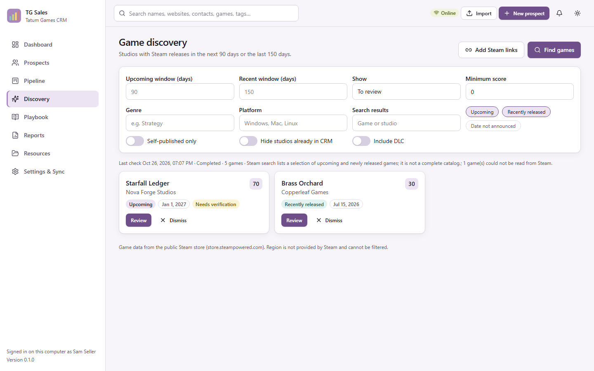 | 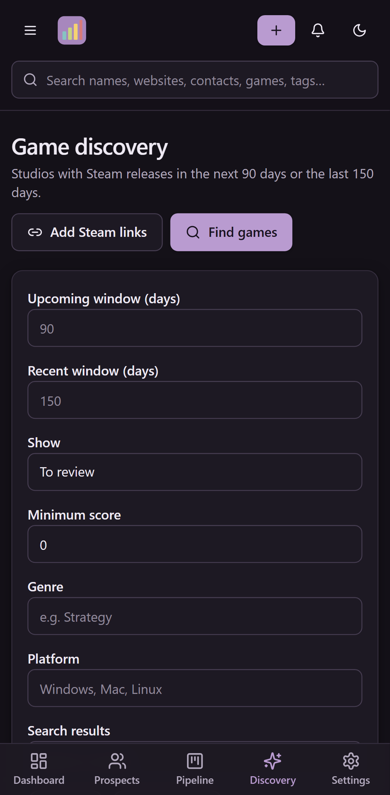 |
| 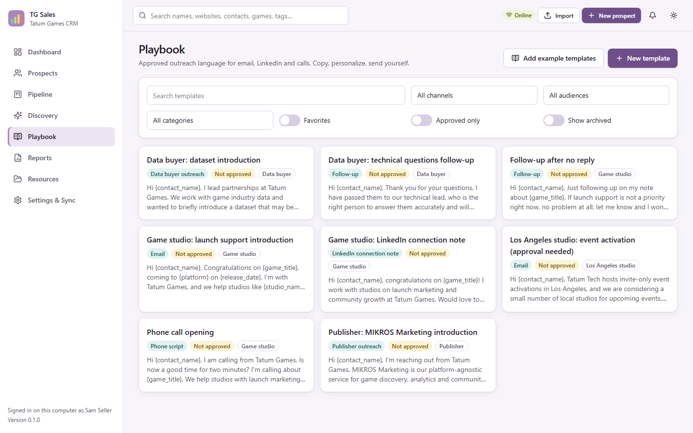 | 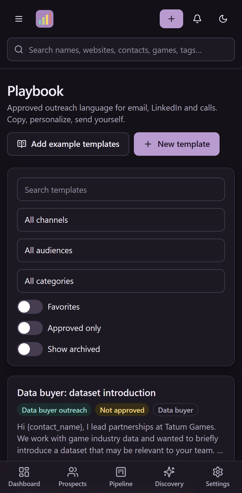 |
| 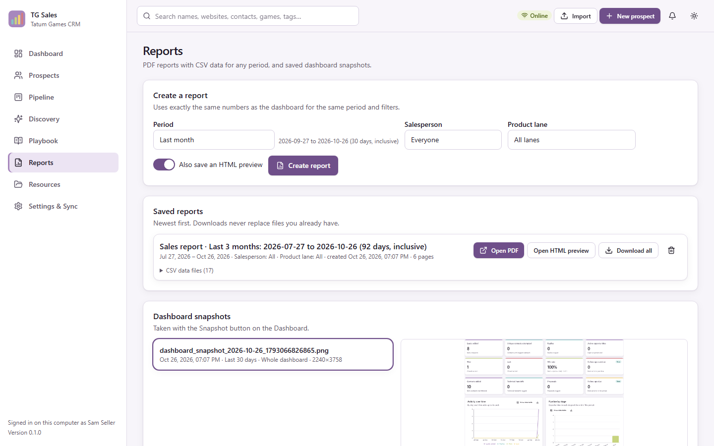 | 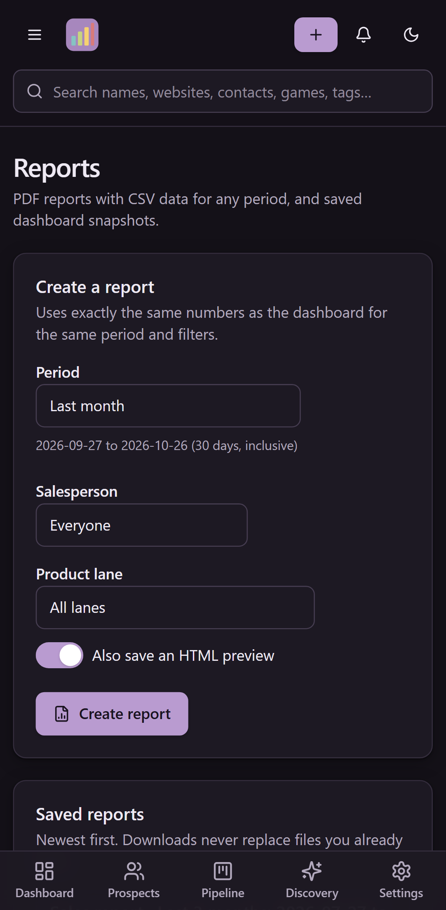 |
| 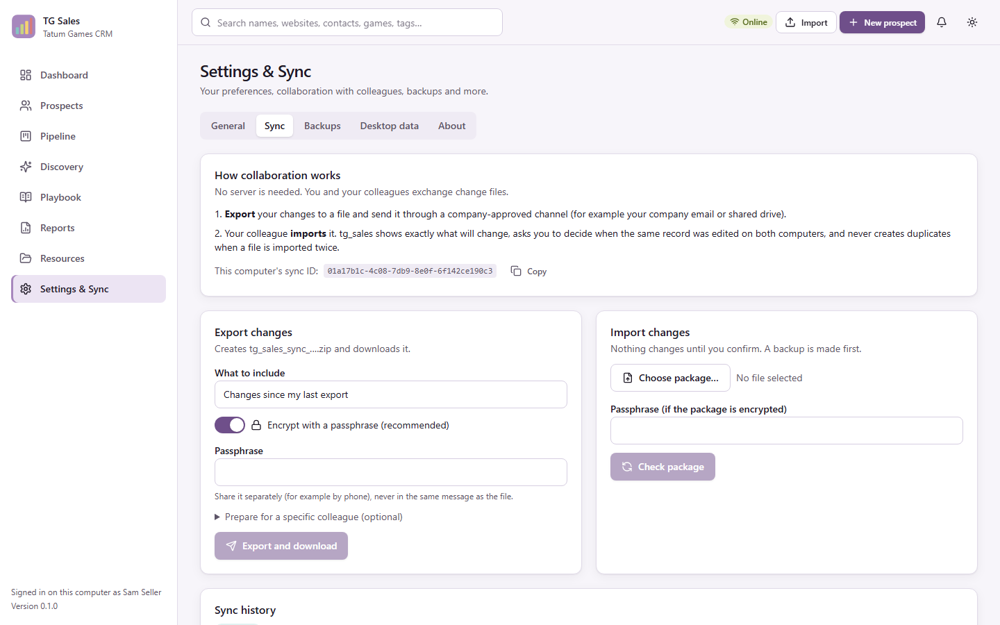 | 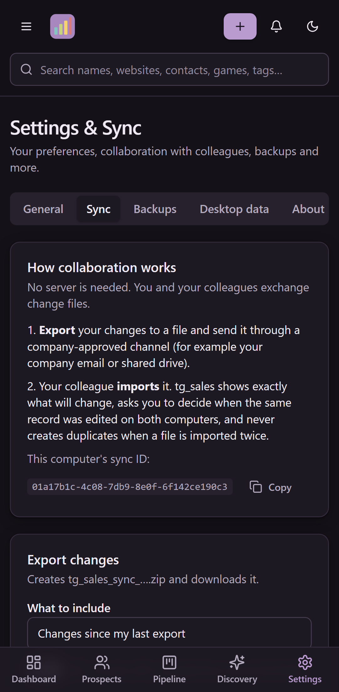 |

Screenshots use synthetic data from the browser tests
(see [TESTING.md](TESTING.md#documentation-screenshots)).
